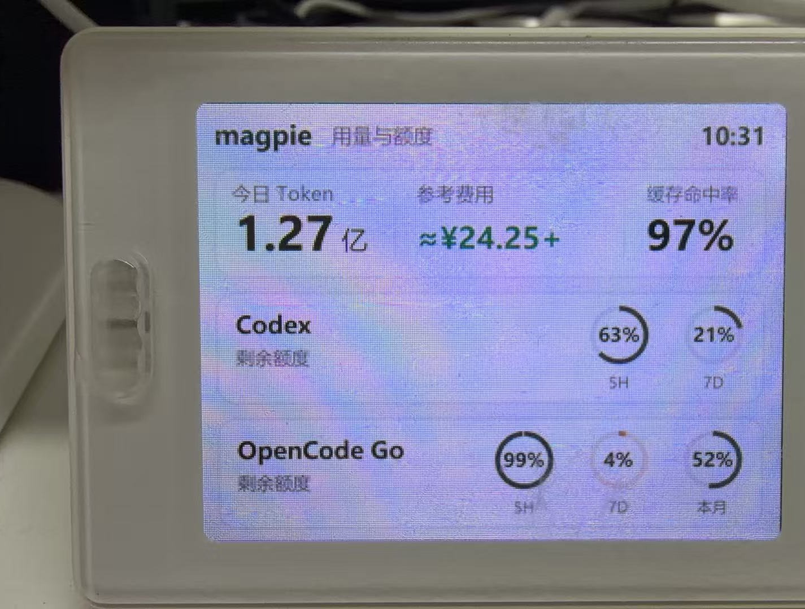
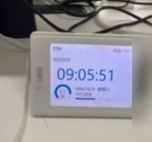

# Magpie LCD Bridge

把 Windows 本机 Magpie 的今日 AI 用量与额度，显示到 DA14585 主控的 320×240 BLE TFT 液晶屏。

这是一个面向 Windows 的开源个人工具。程序只读取 Magpie 的本地接口，不读取账号密钥，不抓取 Magpie 界面，也不修改屏幕固件。

## 显示内容

- 今日 Token 总量
- 参考费用（USD 按配置汇率换算为 CNY）
- 缓存命中率
- 两组供应商额度圆环
- 每个圆环的剩余百分比和短标签

默认显示 Codex 和 OpenCode Go。打开托盘 `设置` 可以从 Magpie 当前额度中勾选要显示的供应商和窗口；高级用户仍可直接编辑本机 `config.json` 调整标题和短标签。

## 实机示例



开发阶段的实机运行照片。照片已裁除设备右侧的条码/标识区域；界面中的字号、圆环尺寸和间距属于当时版本，最终效果以当前代码渲染结果为准。



BLE 断开或程序停止后，设备会回到固件自带的时钟模式。使用 `push` 后看到该画面是预期行为；持续显示应使用托盘控制器、`run` 或旧版登录自启任务。

## 硬件来源

本项目使用的实体硬件购自闲鱼卖家 `边玩边卖`。下面的截图仅用于说明硬件商品来源，已裁除卖家个人标签和其他非必要信息。


## 这个项目适合谁

适合以下使用方式：

- 桌面上有一块 DA-LCD 小屏，希望长期显示 AI 用量而不是电脑资源。
- 使用 Magpie 管理 Codex、OpenCode Go 或其他本地已接入的供应商。
- 希望程序在 Windows 登录后自动运行，并且不弹出控制台窗口。
- 接受约 60 秒一次的数据刷新，不需要秒级实时刷新。
- 可以运行 PowerShell，并愿意维护一个 Python 虚拟环境。

不适合以下需求：

- 需要同时连接多块屏幕或多个控制端。
- 需要 macOS、Linux 或手机端运行。
- 需要显示路由状态、网络访问记录或历史曲线。
- 需要修改固件、执行 OTA 或替代原厂控制器。
- 需要屏幕在 BLE 断开后长期保留最后一帧。

更完整的适用场景和限制见 [`docs/compatibility.md`](docs/compatibility.md)。

## 硬件与软件条件

### 已验证目标

| 项目 | 条件 |
| --- | --- |
| 屏幕 | 2.4 英寸、320×240 TFT 彩色液晶屏 |
| 主控 | DA14585 |
| 设备示例 | `DA-LCD-772D` |
| 连接 | Windows BLE |
| 图片特征 | `0000ff01-0000-1000-8000-00805f9b34fb` |
| 协议 | 现有固件的图片传输协议，不修改固件 |

其他型号或其他固件只有在分辨率、图片特征和协议行为一致时才可能工作，但目前没有验证。

### Windows 环境

- Windows，使用可用的 BLE/WinRT 蓝牙栈。
- Python 3.11–3.14；项目内 `.python-version` 固定为 3.12。
- 推荐使用 [uv](https://docs.astral.sh/uv/getting-started/installation/) 安装依赖。
- Windows 中文字体 `msyh.ttc`、`msyhbd.ttc` 和 `segoeuib.ttf` 可用。
- Magpie 正在运行，默认本地接口为 `http://127.0.0.1:3425`。
- DA LCD Studio 已断开；同一时间只能有一个程序占用该 BLE 设备。

项目只在当前 Windows BLE 环境做过实机验证。macOS、Linux、WSL 和 Android 不在当前支持范围内。

## 快速开始

### 1. 安装依赖

```powershell
cd path\to\magpie-lcd-bridge
uv sync
```

### 2. 启动 Magpie，关闭 DA LCD Studio

确认 Magpie 的本地接口可用，并确保屏幕没有被原厂控制器占用。

### 3. 先预览

```powershell
uv run python magpie_lcd.py render
```

检查生成的 `last-frame.png`。预览正确后再连接实体屏。

### 4. 测试一次实体屏

```powershell
uv run python magpie_lcd.py scan
uv run python magpie_lcd.py push
```

`push` 只发送一帧，完成后会断开并可能回到时钟模式。

### 5. 启动托盘控制器

```powershell
Set-ExecutionPolicy -Scope Process Bypass
.\scripts\start-controller.ps1
```

托盘右键菜单提供启动/停止、立即刷新、设置、创建桌面快捷方式和额度配置入口。快捷方式带独立图标；再次点击时，控制器未运行则启动，已运行则直接打开设置。更完整的步骤、计划任务迁移和故障排查见 [托盘控制器说明](docs/controller.md) 与 [完整使用教程](docs/usage.md)。

如果墨笺 InkMemo 也需要使用本机 BLE，请保持托盘控制器运行。墨笺会在真正扫描或传图前通过本机命名管道申请租约；LCD 自动暂停，墨笺完成后恢复。协议和限制见 [跨项目 BLE 租约](docs/ble-coordination.md)。

2026-11-05 已完成部署验证：连续 3 次墨笺校准正常释放 LCD 租约；异常结束墨笺后，LCD 在默认 120 秒 TTL 到期后自动恢复并完成发送。实体屏最终画面仍需用户目视确认。

## 使用方案

### 方案一：只预览，不连接屏幕

用于确认 Magpie 数据和排版是否正常：

```powershell
cd path\to\magpie-lcd-bridge
uv sync
uv run python magpie_lcd.py render
```

输出文件是 `last-frame.png`，不会占用蓝牙设备。

### 方案二：一次性推送

用于临时更新一帧：

```powershell
uv run python magpie_lcd.py push
```

`push` 会连接设备、发送一帧、退出并断开 BLE。断开后设备可能回到固件自带的时钟模式，这是预期行为。

### 方案三：持续运行

用于前台观察或调试：

```powershell
uv run python magpie_lcd.py run --interval 60
```

程序会保持 BLE 连接，每 60 秒读取一次 Magpie、渲染一帧并发送。重连时只显式扫描一次，并把扫描得到的设备对象交给 Bleak，避免底层再次隐式扫描。Magpie 的 HTTP 读取在后台线程执行，不会阻塞 BLE 事件循环。单次 BLE 写入超过 10 秒会中止；断线后约 10 秒进入下一次连接尝试。

### 方案四：托盘控制器（推荐日常使用）

首次启动控制器：

```powershell
Set-ExecutionPolicy -Scope Process Bypass
.\scripts\start-controller.ps1
```

它不会打开控制台窗口，托盘菜单可完成启动/停止、立即刷新、设置和退出。刷新间隔和登录自启可在设置窗口中调整。详见 [托盘控制器说明](docs/controller.md)。

登录自启使用当前用户的隐藏任务 `Magpie LCD Bridge Controller`，可在托盘设置中开启，或执行 `.\scripts\install-controller-autostart.ps1`。首次安装会同时创建桌面快捷方式 `Magpie LCD Bridge.lnk`，之后也可以从设置窗口重建。安装成功后会移除本项目原来的注册表 Run 项；实际注销/登录后的启动需要单独验证。

### 方案五：旧版计划任务（兼容/回退）

如果不需要托盘，仍可安装原有的隐藏计划任务：

```powershell
Set-ExecutionPolicy -Scope Process Bypass
.\scripts\install-autostart.ps1
```

它会创建当前用户的旧 worker 任务 `Magpie LCD Bridge`，在 Windows 用户登录后使用 `.venv\Scripts\pythonw.exe` 启动。不要同时启用旧 worker 任务和新控制器任务。

## 日常开关

在项目目录打开 PowerShell：

```powershell
cd path\to\magpie-lcd-bridge
Set-ExecutionPolicy -Scope Process Bypass
```

### 托盘控制器

```powershell
.\scripts\start-controller.ps1
.\scripts\status-controller.ps1
.\scripts\stop-controller.ps1
```

托盘控制器是推荐入口；日常启停、刷新间隔和自启优先在托盘设置中操作。

### 旧版计划任务

### 启动

```powershell
.\scripts\start-magpie-lcd.ps1
```

启动隐藏计划任务；需要先执行过一次 `install-autostart.ps1`。

### 停止

```powershell
.\scripts\stop-magpie-lcd.ps1
```

停止计划任务和本项目的桥接进程，释放 BLE。停止后设备会回到时钟模式，此时可以打开 DA LCD Studio。

### 查看状态

```powershell
.\scripts\status-magpie-lcd.ps1
```

显示任务状态、最近运行时间、进程 PID。后台日志默认在：

```text
logs\magpie-lcd.log
```

### 取消开机自启

```powershell
.\scripts\uninstall-autostart.ps1
```

停止桥接并删除计划任务，但不会删除项目源码、`config.json` 或历史日志。

## 扫描设备

```powershell
uv run python magpie_lcd.py scan
```

如果机器附近有多台 `DA-LCD-` 设备，可以在单次命令中指定地址：

```powershell
uv run python magpie_lcd.py push --address "DA-LCD 的蓝牙地址"
uv run python magpie_lcd.py run --address "DA-LCD 的蓝牙地址"
```

当前自启脚本没有提供地址参数；多设备场景需要自行调整脚本，暂不是开箱即用功能。

## 额度配置

日常选择推荐从托盘菜单打开 `设置`，在“额度显示”区域读取 Magpie 当前额度并勾选：

- 最多选择两个供应商，对应屏幕上的两张额度卡。
- 每个供应商最多选择三个窗口，对应每张卡最多三个圆环。
- 勾选后的窗口按短周期优先排列：`5H → 7D → 本月`。
- 保存后写入本机 `config.json`；Magpie 不可用时保留原配置。
- 保存成功会在窗口底部显示“设置已保存”，不再弹出阻塞式确认框。

需要自定义短标签或标题时，再手动编辑 `config.json`。

复制示例配置：

```powershell
Copy-Item config.example.json config.json
```

编辑 `config.json` 的 `quota_groups`：

- `provider`：Magpie `/v1/magpie/quotas` 返回的供应商 ID。
- `title`：屏幕上显示的卡片标题。
- `windows[].name`：Magpie 返回的窗口名称。
- `windows[].label`：屏幕下方的短标签，例如 `5H`、`7D`、`本月`。

屏幕固定显示两行额度卡；每行最多渲染三个圆环，超出的窗口不会显示。`config.json` 只保留在本机，已经加入 `.gitignore`。

如果某个供应商或窗口暂时没有数据，屏幕上会显示短横线，不会伪造额度。

完整的供应商查询、字段说明、示例配置、环境变量和故障排查见 [配置教程](docs/configuration.md)。

## 数据、隐私与边界

- 只读用户配置的 Magpie 本地接口，默认是 `http://127.0.0.1:3425`。
- 不读取 Magpie 账号、邮箱、Cookie 或 API 密钥。
- 不抓取 Magpie 界面，不向外部服务器上传数据。
- 不修改固件、不执行 OTA、不把设备地址写入公开仓库或上传。
- 蓝牙地址只在本机通过 `scan` 或手动 `--address` 使用，不写入公开仓库。
- `last-frame.png`、`logs/`、`config.json` 和虚拟环境不会提交到 Git。

## 刷新与断线行为

- 默认刷新间隔是 60 秒，不是秒级实时推送。
- Magpie 读取失败时，已有数据会标记为“数据已过期”；首次没有数据时显示“暂未读到 Magpie”。
- BLE 断开后，程序会清理旧连接并在短延迟后重试。
- 设备断电、Windows 蓝牙关闭或 DA LCD Studio 占用连接时，屏幕可能暂时显示时钟模式。
- 当前不保证 BLE 断开后屏幕永久保留最后一帧。

## 常见问题

### 屏幕回到时钟模式

先检查是否执行了 `push`。`push` 发送完会主动断开，这是设计行为。日常应使用 `run` 或自启任务。

然后检查：

```powershell
.\scripts\status-magpie-lcd.ps1
Get-Content .\logs\magpie-lcd.log -Tail 30
```

### 找不到设备

- 确认屏幕已上电。
- 确认 Windows 蓝牙已开启。
- 关闭 DA LCD Studio 后再扫描。
- 运行 `uv run python magpie_lcd.py scan` 检查设备发现。

### 无法连接或设备被占用

该屏幕同一时间只接受一个 BLE 连接。先停止 DA LCD Studio，或执行：

```powershell
.\scripts\stop-magpie-lcd.ps1
```

### 页面有旧数据

检查 Magpie 是否仍在运行，以及本地接口是否可访问：

```powershell
Test-NetConnection 127.0.0.1 -Port 3425
```

程序不会在读取失败时清空最后一次成功数据，而会在屏幕上标记过期状态。

## 自检

```powershell
uv run python -m unittest -v
```

当前测试覆盖协议编码、额度映射、画面生成、成本三位数排版、BLE 写入超时、扫描设备复用、旧连接回调隔离、限时连接清理、后台数据读取、失败重连间隔，以及托盘设置、间隔校验和 worker 生命周期。

## 文档

- [完整使用说明](docs/usage.md)
- [配置教程](docs/configuration.md)
- [适用场景、条件和限制](docs/compatibility.md)
- [设备说明](docs/device.md)
- [BLE 图片协议](docs/protocol.md)
- [运行与维护](docs/operations.md)
- [Windows 托盘控制器](docs/controller.md)
- [实机图片说明](docs/images/README.md)

## 致谢

感谢两方面的来源：

- 原始控制器与固件作者过往烟云（[`tsl0922`](https://github.com/tsl0922)）：感谢其为 DA14585 液晶屏提供原始控制器、固件和配套功能。
- 闲鱼卖家 `边玩边卖`：感谢其提供本项目使用的硬件实物和商品来源。

本项目是独立桥接工具，只复用设备已有的 BLE 图片传输协议行为，不包含原控制器源码。硬件来源致谢不代表卖家是原始控制器作者或本项目代码作者。详见 [`NOTICE.md`](NOTICE.md)。

## 许可证

本项目使用 MIT License，详见 [`LICENSE`](LICENSE)。
