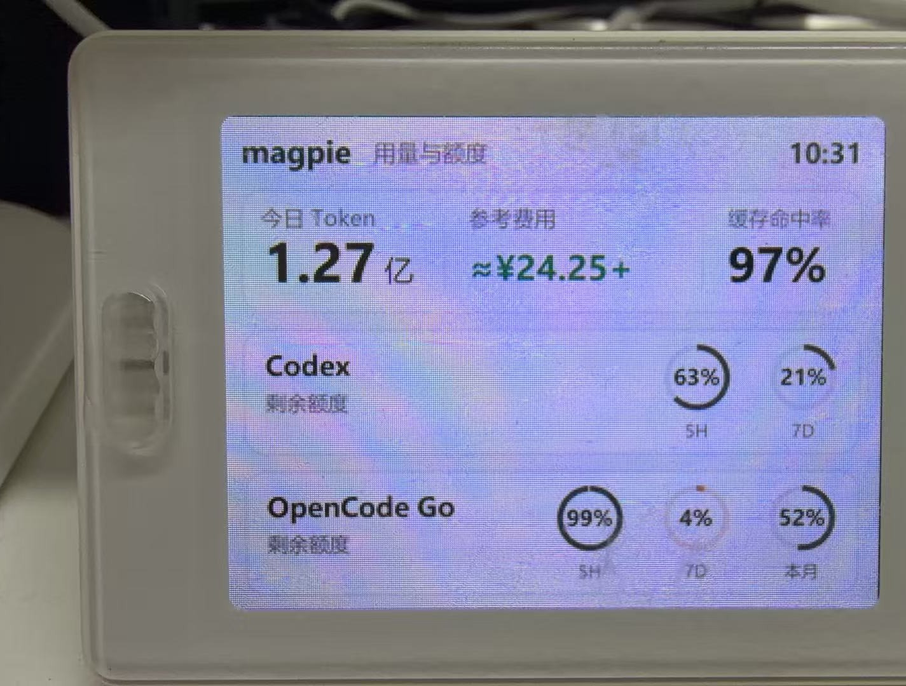
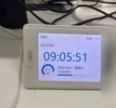

# 设备说明

- 设备型号：`DA-LCD-772D`
- 屏幕：2.4 英寸、320 × 240 TFT 彩色液晶屏
- 主控：DA14585
- 连接方式：Windows BLE
- 固件功能：时钟、电脑资源监控和图片传输
- 图片特征：`0000ff01-0000-1000-8000-00805f9b34fb`

本项目只使用图片传输功能，不修改固件、不执行 OTA、不读取设备账号信息。设备的蓝牙地址不写入公开仓库；使用时可以通过 `scan` 命令发现设备。

## 实机照片

开发阶段实机运行照片。右侧设备条码区域已裁除；画面不是当前版本的像素级截图，最终排版以 `render` 输出为准。

BLE 断开后设备回到固件自带的时钟模式。

